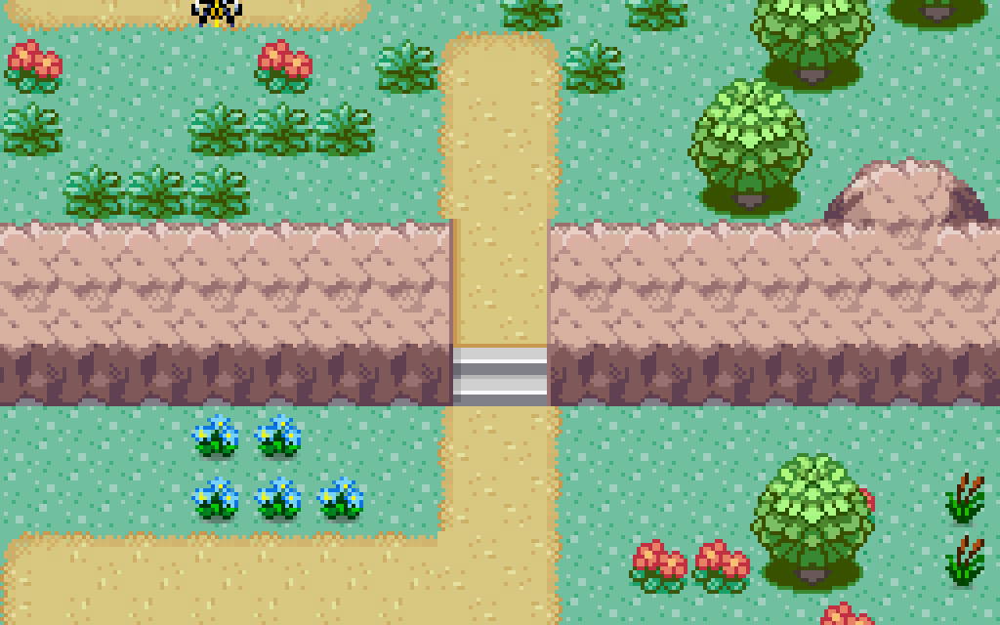
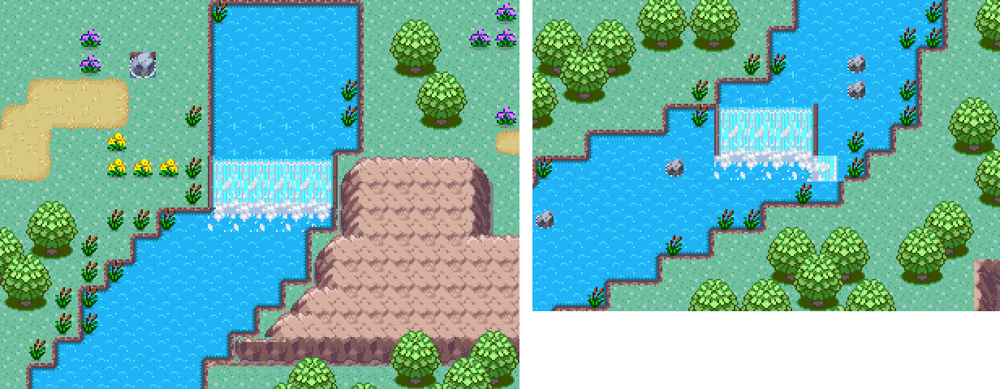

# Bosque del Cauce — composición desde el mock

Escena seleccionada: `Assets/Scenes/BosqueDelCauce 3.unity`.

El autor pidió trasladar el mock de pixel art al Editor con los assets reales. Se creó una composición estática editable de 64 × 48 casillas. La escena respeta Grid con Colliders, Terrain, Terrain LV1 y Foreground; los personajes son objetos separados del dibujo estático.

## Correspondencia visual

| Lugar del mock | Implementación con los assets existentes |
| --- | --- |
| Entrada sur | Entrenador y Pikachu sobre el sendero |
| Río diagonal | Ocean RuleTile, orillas curvas, rocas y un salto de agua del tileset |
| Puente central | Piezas de puente con barandas del tileset, adaptando el puente de madera inventado por el mock |
| Claro oeste | Tres Beedrill, hierba alta decorativa y una Poké Ball |
| Rincón de Haunter | Haunter, fila de árboles, marcador de piedra y columnas de acceso abierto |
| Orilla tranquila | Psyduck junto a la laguna sureste |
| Laguna apartada | Dratini en el estanque noreste con un sendero lateral |
| Claro superior | Machoke y recompensa visual |

La versión seleccionada contiene 243 árboles compuestos en Tilemaps. Se modificó la distribución inicial para romper las filas uniformes y agrupar copas en masas de bosque. Las paredes rocosas siguen tramos del río y los bordes de los claros. Se corrigieron el orden de dibujo de los personajes, la orientación de las escaleras y las piezas del puente mediante revisión de renders reales.

## Física y comprobaciones de autoría

Los bloqueos estáticos están solo en Colliders: huellas de árboles, roca, contorno de agua y perímetro. El puente abre un paso en el contorno del río; entrada y salida se conservan. No se rellenó todo el río con colisiones redundantes. Las capas de dibujo no tienen TilemapCollider2D.

La receta comprobó la forma física en el centro de 983 bloques y una búsqueda cardinal entre ocho puntos principales. El informe está en `design/bosque-validacion.txt`. Esta validación de autoría no demuestra combates, captura, el puzzle de Haunter ni una partida completa.

El marcador y las columnas adaptan visualmente el mecanismo del mock: todavía no son un puzzle conectado. Los Beedrill, Psyduck, Dratini, Haunter y Machoke se colocaron como situaciones visuales; el trabajo de autoría no añadió IA ni combate a esos sprites.

## Conservación e integración

El trabajo que estaba sin guardar al comenzar se preservó en una copia `Assets/Scenes/Reference/AntesDelBosque_20261025*.unity`. Las escenas BosqueDelCauce, BosqueDelCauce 1 y BosqueDelCauce 2 son iteraciones anteriores; la composición seleccionada es BosqueDelCauce 3.

`Assets/Editor/ForestMockAuthoring.cs` es una receta de autoría visual en Edit, no un constructor en Play. No volver a ejecutarla sobre una integración de gameplay: crea nuevas escenas visuales y no incorpora por sí sola los controladores de la demo.

La tarea «Mejorar animación del player» integró el prefab PlayerWithCamera, la cámara hija del actor y NeoExplorationScene en BosqueDelCauce 3 sin regenerar los Tilemaps. El entrenador visual original se conserva desactivado, sustituido por el player jugable. La cámara general se conserva desactivada como referencia; solo la cámara y el listener del player quedan activos. El usuario autorizó coordinar entre ambos chats. Esta tarea dejó de cambiar escenas, compilar o controlar Play para permitir esa integración. Conservar los scripts y prefabs de la otra tarea.

Se verificaron en Play seis condiciones: ocho pasos de (39,4) a (39,12), cámara real con PixelPerfect centrada en el actor, desplazamiento del grafo con el player, correspondencia de nodos con suelo/paredes/rocas, rechazo de una pared y rechazo de suelo vacío. El informe proporcionado por la otra tarea se leyó y conservó en `design/bosque-exploracion-validacion.json`. Es una prueba de exploración y cámara, no un recorrido completo de todos los lugares.

Captura general final después de la integración, revisada visualmente: `design/evidencias/bosque-del-cauce-unity.png`, cámara temporal de autoría en (32,24,-50), ortográfica 24, salida 1536 × 1152. La captura se realizó sin modificar la cámara hija del jugador.

## Pokémon que pasean

Pikachu, Psyduck, los tres Beedrill, Dratini, Haunter y Machoke son prefabs en `Assets/Prefabs/Pokemon/`. La raíz está en la casilla de los pies y lleva `Seeker`, `NeoGridMotor` y `NeoWildPokemon`; el hijo `Render` lleva el sprite, el Animator y `NeoYSort`.

### Tamaño canónico (huella)

Cada Pokémon ocupa `NeoGridMotor.footprint` casillas (ancho × alto) desde la casilla de los pies hacia la derecha y hacia arriba. El motor reserva todas las casillas nuevas de cada paso, o ninguna; en reposo `NeoWildPokemon` las retiene todas, así nadie se le superpone. El jugador sigue en 1 × 1.

| Pokémon | Altura canónica | Huella |
| --- | --- | --- |
| Pikachu | 0,4 m | 1 × 1 |
| Psyduck | 0,8 m | 1 × 1 |
| Beedrill | 1,0 m (vuela) | 1 × 1 |
| Dratini | 1,8 m de largo | 2 × 1 |
| Haunter | 1,6 m, ancho | 2 × 2 |
| Machoke | 1,5 m, corpulento | 2 × 2 |

Los más grandes llegarán a 3 × 4.

### Generación

**Neo › Pokémon › Generar Pokémon (animaciones, tamaño y prefabs)** (`Assets/Editor/NeoPokemonAuthoring.cs`) crea o actualiza, por especie, los clips idle/caminata en `Assets/animations/<Pokémon>/`, su Animator Controller y el prefab. El dibujo se escala para cubrir el 95 % de la huella, centrado y apoyado en el borde inferior, según los píxeles visibles de todos sus frames. Para cambiar frames, velocidad o huella se edita la tabla del script y se vuelve a ejecutar. Regenerar sobrescribe esos clips y controllers; `Assets/animations/Hunter/` queda como estaba.

En los sheets de Psyduck, Dratini y Machoke solo las columnas 0–2 son paso; las siguientes son poses o ataques. Como casi no hay frames de idle, `NeoWildPokemon` agrega una respiración en reposo y el flotado de Haunter y Beedrill.

### Paseo

`NeoWildPokemon` elige una casilla al azar dentro de `wanderRadius` con toda la huella libre, pide la ruta al A* y camina hasta `maxStepsPerWalk` casillas; luego descansa entre `pauseRange`. Solo planifica dentro del grafo de 32 × 20 que sigue al jugador. Para cuerpos de más de una casilla la ruta del A* se calcula para la casilla de los pies; si un paso choca, descansa y elige otro destino.

`NeoYSort` ordena por la Y de los pies (5000 − 10·y) a los sprites de personajes y al Render del jugador.

Validado en Play junto a cada grupo: los ocho Pokémon caminan y retienen su huella, y los que quedan fuera del grafo no se mueven. Revisadas capturas de cerca de cada uno. No se jugó un recorrido completo a ojo.

## Playa animada

La playa junto a Psyduck usa `NeoShoreTile` (`PlayaArena`) en la capa Water, sobre arena en Terrain. Funcionamiento, estilos y cómo pintar otras costas: [ORILLAS.md](ORILLAS.md).

## Orilla oeste (rehecha)

Todo lo que queda al noroeste del río se reconstruye con **Neo › Autoría › Rehacer orilla oeste del bosque** (`Assets/Editor/NeoWestBankAuthoring.cs`). La región se calcula sola: las casillas secas que se alcanzan desde la esquina noroeste sin cruzar el río. El río, el puente y el resto del mapa no se tocan. Antes de la primera corrida del día guarda la escena como `Assets/Scenes/Reference/AntesDeOrillaOeste_<fecha>.unity`; volver a correrla rehace la orilla igual (el ruido es determinista).

| Lugar | Qué es |
| --- | --- |
| Sendero del Cauce | Del puente hacia el oeste y luego al norte (PathTile, 2 de ancho). |
| Peñón | Cresta de roca (`Mountain`) de borde a río, en y 30–32 con dos lomas; solo se cruza por la escalera tallada `EscaleraMontana` (x 17–18, ver abajo). |
| Claro de los Beedrill | Óvalo con centro de arena, anillo de pasto alto y flores. Los tres Beedrill viven aquí; la Poké Ball oeste está escondida en el pasto (6, 41). |
| Mirador del río | Ramal al noreste hasta un claro frente a la cascada. |
| Laguna del Bosque | `LagoPasto` (ver [ORILLAS.md](ORILLAS.md)), con juncos y un claro al norte; todo su agua bloquea. |
| Bosque | Dos pasadas intercaladas: denso en los bordes del mapa, con claros naturales adentro. Margen libre con juncos junto al río. |

El contorno del río ahora bloquea en todo su recorrido y en ambas orillas, salvo bajo el puente; antes solo 19 de sus 368 casillas bloqueaban y el agua se podía caminar desde el este.

Validación (`docs/design/orilla-oeste-validacion.txt`): desde la entrada (39, 4) se llega a pie al puente, la escalera, el claro, el mirador, la laguna, la Poké Ball y los tres Beedrill; con la escalera cerrada el claro queda inaccesible. En Play se subió la escalera caminando y los Beedrill pasean en el claro. Los lugares del este siguen alcanzables salvo (59, 18), un bolsillo entre rocas que ya estaba cerrado antes de estos cambios.

### Escalera tallada en el Peñón

Antes la escalera era una baldosa gris (`Pallete1_207`) entre dos remates redondeados de `Mountain`: parecía metida entre dos piedras y no subía a ningún lado, porque el pasto de los dos lados se leía a la misma altura.

Ahora es `EscaleraMontana` (`Assets/Sprites/AniamtedTiles/`), un RuleTile que elige su pieza según dónde está dentro de la escalera. Los escalones suben solo por la **cara** de la roca (la fila de abajo). Arriba sigue un sendero tallado en la cima, que llega al claro a la misma altura: así se entiende que el claro está más alto que el sendero del sur. Las mejillas del corte usan la misma textura de la roca.

`Mountain` y `PathTile` ahora son `NeoFriendRuleTile`: un RuleTile con una lista `friends` de tiles que cuentan como propios en las reglas This / Not This. Por eso la roca sigue de corrido hasta la escalera en vez de cerrarse en remates, y el sendero llega a los escalones sin cortarse. Sirve para cualquier ancho (1, 2, 3 o más columnas) y alto de cresta.

- Para pintar otra escalera: pintar `EscaleraMontana` atravesando una cresta de `Mountain`, de arriba a abajo. Dejar libres esas casillas en `Colliders`.
- Para retocar el dibujo: `python tools/generate_mountain_stairs.py` regenera `MountainStairs.png`, que también se puede editar en Aseprite. Después, **Neo › Tiles › Crear escalera de montaña** reimporta las piezas y rearma las reglas sin perder las referencias.
- Las escaleras de los otros acantilados del mapa (repisas armadas a mano con `Pallete1_124/145`) siguen con `Pallete1_207`.

## Ríos con niveles

El río usa `NeoRiverTile` ([RIOS.md](RIOS.md)) en el Tilemap `Rio`, con tres niveles y dos cascadas. Lo aplica **Neo › Autoría › Río con niveles y cascadas en el bosque** (se puede volver a ejecutar para cambiar niveles o cascadas) (`Assets/Editor/NeoRiverBosqueAuthoring.cs`); la escena anterior quedó en `Assets/Scenes/Reference/AntesDelRioNiveles_20261025.unity`.

| Tramo | Nivel | Casillas |
| --- | --- | --- |
| Estanque norte | 2 | y ≥ 42 |
| **Salto del Estanque** | cascada de 5 × 2 | x 36–40, y 40–41; reemplaza el sprite de cascada de 3 × 3 (`Pallete1_185`) que estaba en Terrain LV1 |
| Río medio (puente incluido) | 1 | y 14–39 |
| **Salto Partido** | cascada de 4 × 2 hacia la cámara + cascada lateral de 1 × 1 | frontal x 19–22, y 12–13; lateral x 23, y 11. El canal de la derecha (x 23–26) sigue en nivel 1 bajando junto a la cascada y vuelca de costado hacia el oeste al pie |
| Río bajo hasta la salida sudoeste | 0 | y ≤ 12, salvo el canal alto |

**El terreno baja con el río (Salto Partido).** Una cascada solo se lee como bajada si el suelo de los costados también baja. Por eso la receta pone un acantilado `Mountain` (el estilo del Peñón):

- **Orilla oeste**, x 13–18, y 12–13: las mismas filas que la cara de la cascada. Ocupa el lugar del agua de nivel 0 que había al lado de la cara, que daba la sensación de que el agua de abajo subía hasta la pared. No tiene escalera: esa orilla está encerrada por el bosque y el jugador no llega.
- **Orilla este**, x 24–32, y 10–11: dos filas más abajo, donde el canal alto vuelca de costado, y en línea con el escalón que ya existía en x 33–36. Lleva una `EscaleraMontana` de 2 de ancho en x 26–27 para no cortar el camino. Se sacaron los dos árboles que tenían el tronco sobre la roca; los árboles de abajo quedan delante de la pared (la receta no borra copas).

Rocas en `Colliders` (BoundaryCell); la escalera queda libre. Alcance desde la entrada (39, 4), medido en Edit: solo se pierden las 9 casillas que ahora son roca, y la escalera conecta y 9 con y 12. El río quedó en 360 casillas, todas con sprite en Edit y en Play. Captura: `design/evidencias/bosque-salto-partido-escalon.png`. Copia previa: `Assets/Scenes/Reference/AntesDelRioNiveles_20261025_1957.unity`.

Se pasaron las 367 casillas de `River` de Water a `Rio`; las playas (`PlayaArena`, `LagoPasto`) siguen en Water. Puente, rocas, juncos y Colliders no se tocaron: el contorno del río sigue bloqueando igual. Verificado en Edit, en Play y al volver de Play (367 casillas, todas con sprite). Capturas: `design/evidencias/bosque-rio-niveles.png`.

