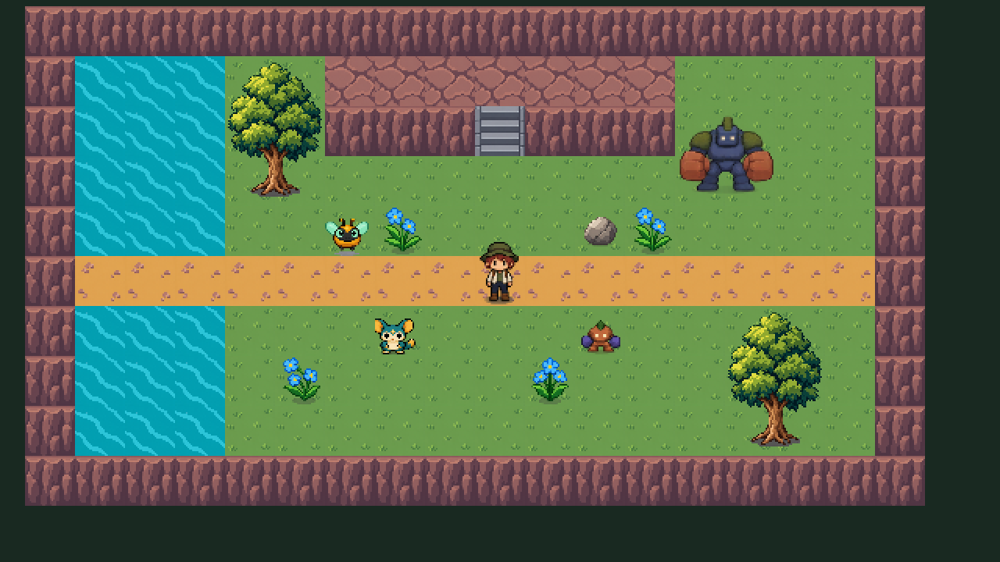

# Referencia jugable de 32 × 32

Primera entrega del plan, 25 de octubre de 2026. La migración del catálogo y de todas las escenas **todavía no está terminada**.

## Probar

Abrir `Assets/Scenes/Visual32Reference.unity` y pulsar Play. También se puede reconstruir con **Neo → Visual 32 → Crear referencia jugable**; este comando reemplaza únicamente esa escena de referencia. Antes de cambiar de escena conserva cualquier escena abierta que esté modificada.

- WASD o flechas: caminar.
- Espacio: alternar explorador y Pedrugo.
- E, junto a la roca y controlando a Pedrugo: empujar.
- Clic izquierdo, controlando a Pedrugo: ataque existente con la nueva animación direccional.

La referencia contiene explorador, Lumin, Brispa, Pedrugo y Granugo; terreno, camino, escalera, árbol, agua animada, flores animadas y roca empujable. Las criaturas silvestres conservan su comportamiento; Pedrugo sigue al explorador cuando se devuelve el control.

## Qué se implementó

- Una unidad de mundo por casilla; importación a 32 PPU, Point, sin compresión ni mipmaps.
- Explorador de 32 × 48; tres criaturas de 32 × 32; Granugo de 64 × 64. El tamaño del lienzo se conserva separado de las huellas originales de los motores.
- Frente, espalda y costado; dos poses de reposo, cuatro de movimiento y cuatro de acción por orientación. El costado opuesto se refleja.
- 150 poses de personajes en cinco hojas y 45 clips. Las acciones del catálogo están disponibles; el ataque real se conecta a Pedrugo, que ya tiene combate. No se agrega combate a criaturas que no lo tenían.
- Cámara **URP** Pixel Perfect de 640 × 360, ampliación entera y márgenes. Desactivados HDR, MSAA y posprocesado en esta cámara.
- Terreno simplificado por indicación del usuario: menos textura en césped, camino y acantilados para destacar las criaturas.
- Material de recorte para eliminar el halo semitransparente del árbol. El resto del arte conserva su transparencia.
- Un importador reproducible que conserva los identificadores de las subdivisiones y los assets nuevos al regenerar.
- Medidas de la referencia centralizadas en `NeoVisualStandard`; los generadores antiguos aún requieren su migración por familias.

Los PNG son **borradores de dirección artística** generados y normalizados a los tamaños del catálogo, revisados también a tamaño nativo y en juego. Esa normalización no se considera acabado final. La prueba automática de poses verifica referencias y reproducción; no certifica por sí sola calidad de silueta, apoyo de pies o coherencia entre dibujos.

## Comprobaciones reproducibles

En **Neo → Visual 32**:

1. **Validar recursos de referencia**: dimensiones, cantidad de sprites, importación, clips y 195 claves reproducidas mediante Animator. Resultado en `docs/validation/visual32-assets.json`.
2. Entrar en Play y ejecutar **Validar referencia en Play**: navegación, persistencia de las 180 casillas, movimiento de humano y compañero, cambio de control/cámara, empuje, actualización de A*, ataque y movimiento posterior. Sale de Play para restaurar la escena. Resultado en `docs/validation/visual32-runtime.json`.

La segunda comprobación automatiza las mismas rutas de control e interacción, pero no simula físicamente las teclas del teclado. Tampoco prueba todos los puzzles, combate, guardados ni transiciones del proyecto completo.

La referencia se compiló para Windows de 64 bits: **Succeeded, cero errores, 517 advertencias**, en aproximadamente 95 segundos. Las advertencias incluyen importación antigua de DotNetZip/A*, APIs obsoletas y shaders de Sentis; están agrupadas en `docs/validation/visual32-build.json`. No se cambiaron dependencias para ocultarlas. La consola del Editor también conserva el error del comprobador HTTP de actualizaciones de A*, observado antes de esta entrega.

Se inició el ejecutable en segundo plano con Direct3D 11: permaneció activo, inicializó navegación y no registró excepciones durante la prueba de arranque. Esto no sustituye la inspección visual ni la interacción manual del ejecutable. Evidencia en `docs/validation/visual32-player-smoke.json`. Ejecutable local: `Builds/Visual32Reference/Neo32.exe`; no se agrega el binario a Git.

## Recuperación y siguientes entregas

Respaldo previo: commit `b740e09a989d217e1fc3f993bd90880cfe7c0129`, etiqueta `backup/pre-32x32-2026-10-25`, en GitHub. La correspondencia de esta referencia está en `visual32-migration-map.json`.

Las escenas de producción y las familias antiguas no se han convertido aún a este catálogo. BosqueDelCauce tenía cambios pendientes en el Editor: se guardaron para conservarlos al abrir la referencia; no se rediseñó su distribución.

Queda producir y revisar las familias completas: criaturas restantes y personajes, terreno y arquitectura con sus transiciones, orillas/cascadas/espuma, decoración reactiva y sombras, efectos e interfaz. Después se podrán promover las familias, actualizar importadores y escenas funcionales y validar puzzles, combate, guardados y compilación general. Las variantes derivadas deben regenerarse desde sus familias.

Antes de promover este arte se deben revisar especialmente continuidad de animación, apoyos y sombras, detalle del árbol frente al terreno simplificado y conexiones del agua con sus orillas. La referencia actual no constituye una familia completa de río ni un sustituto del terreno de todos los mapas.
