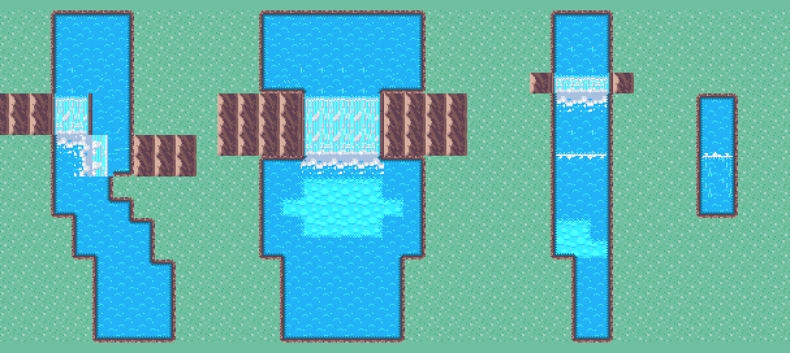

# Ríos con niveles y cascadas

`NeoRiverTile` es un tile de río que sabe a qué **altura** está el agua. Se pinta el agua de cada nivel y las cascadas donde el río baja; cada casilla mira a sus vecinas y arma sola las orillas, la corriente, los labios donde el agua derrama, la lámina de las cascadas, las salpicaduras y la espuma.



Escena de muestra: `Assets/Scenes/Reference/RioNiveles_Muestra.unity` (se regenera con **Neo › Tiles › Crear escena de muestra del río**).

## Assets

En `Assets/Sprites/River/`:

| Asset | Qué es |
| --- | --- |
| `Rio_N0` … `Rio_N3` | Agua profunda de nivel 0 (el más bajo) a 3 |
| `RioBajo_N0` … `RioBajo_N3` | Agua baja del mismo nivel: se ve el lecho de piedritas; se funde con el agua profunda de su nivel |
| `Cascada` | La caída. No tiene nivel: lo toma del agua de arriba y de abajo |
| `rio_cauce.png` | Plantilla de materiales (agua, bajo, roca de orilla, lámina, espuma, pared) |

Si se borran, **Neo › Tiles › Crear tiles de río (niveles 0-3)** los vuelve a crear.

**Tile Palette:** `Assets/Pallete/Rio.prefab`. En la ventana Tile Palette elegí la paleta **Rio**: arriba está `Cascada`, al medio el agua baja y abajo el agua profunda, de nivel 0 a 3. Los tiles están separados para que cada uno se vea solo. **Neo › Tiles › Crear Tile Palette del río** la rehace.

## Cómo pintar

Todo va en un Tilemap propio (en la muestra y en el bosque, `Rio`), entre Terrain y Terrain LV1, con el material de sprites por defecto. No usar el Tilemap `Water`: su material `RiverFreshwater` volvería a aclarar los azules.

**Agua dulce.** Cada asset tiene la casilla `freshwater`, que aplica el mismo ajuste de color que `RiverFreshwater.shader` (agua celeste como el río del bosque). Viene activada en los nueve assets; desactivada da el azul oscuro del mar.

1. **Agua.** Pintar cada tramo con el nivel que corresponde. Lo que queda río arriba tiene un nivel mayor.
2. **Cascada hacia la cámara.** Entre un tramo alto (arriba) y uno bajo (abajo), pintar filas de `Cascada`. El **ancho** es cuántas columnas pintás (3, 4, las que sean) y la **altura** cuántas filas (1 fila = caída corta; 3 filas = la pared es más alta). Arriba se dibuja el labio, abajo la salpicadura y en el agua de abajo la espuma. A los costados de la cascada se dibuja pared de roca; en Terrain LV1 conviene seguir el acantilado a ambos lados.
3. **Cascada de costado.** Pintar `Cascada` entre dos aguas de distinto nivel **a izquierda y derecha**: el tile detecta el lado alto y vuelca hacia el bajo.
   Si una cascada tiene distinto nivel **en las dos direcciones** (arriba/abajo y también izquierda/derecha), gana su lado largo: si es más ancha que alta cae hacia la cámara y si es más alta que ancha cae de costado. Así una cascada frontal puede tener agua baja en un extremo de su fila (como el Salto Partido del bosque). Si una cascada lateral queda pegada a una frontal en la misma fila, se cuentan juntas y caen las dos hacia la cámara: dejá una casilla de agua entre ellas o ponela en otra fila.
   **El terreno también baja.** Una cascada se lee como bajada solo si el suelo a sus costados baja con ella: poné acantilado (`Mountain` en Terrain, o el escalón de Pallete1) en las mismas filas que la cara de la cascada, y no dejes agua del nivel de abajo al costado de la cara. Si una parte del río sigue alta y cae de costado, el acantilado de ese lado va más abajo, en las filas donde cae (ver el Salto Partido en [BOSQUE_DEL_CAUCE.md](BOSQUE_DEL_CAUCE.md)).
4. **Escalón chico (rápido).** Agua de un nivel pegada a agua de un nivel menor, sin cascada en medio: el lado alto dibuja una línea de espuma donde derrama y el bajo espuma donde cae. Funciona en las cuatro direcciones; hacia arriba se lee como un río que sube alejándose de la cámara.

### El ejemplo del río de 4 que se divide

```
. . 2 2 2 2 .
. . 2 2 2 2 .      2 = Rio_N2, 1 = Rio_N1, F = Cascada, # = acantilado
# # F F 2 2 .      las dos columnas de la izquierda caen hacia la cámara
# # F F 2 2 .
. . 1 1 F 2 #      las otras dos siguen a nivel 2 y caen de costado
. . 1 1 F 2 #
. . 1 1 1 . .
```

## La corriente

El agua corre sola hacia la caída más cercana de su nivel (una cascada que alimenta o agua más baja), en 8 direcciones. A una casilla de la caída se vuelve rápido: va al doble de velocidad y muestra vetas. Si un tramo no tiene salida (por ejemplo, el nivel 0 que sale del mapa), usa `defaultFlow` del asset (por defecto, hacia abajo).

Al pintar o borrar se recalcula todo el río conectado a esa casilla (hasta 8000 casillas), así la corriente se reorienta sola aunque la caída nueva esté lejos. **Neo › Tiles › Refrescar ríos** recalcula todos los ríos abiertos, por si acaso.

## Colisiones

Como el resto del mapa, el tile no agrega colisiones: se bloquea en `Colliders`. Criterio sugerido: agua profunda y cascadas bloquean; el agua baja se camina. `NeoRiverTile.Walkable` lo dice para herramientas que sincronicen colliders.

## Cómo funciona por dentro

- Cada casilla calcula una **clave** con todo lo que influye en su dibujo: tipo, dirección y velocidad de la corriente, qué hay en cada lado (tierra, mismo nivel, más bajo, más alto, una cascada que cae ahí, agua baja/profunda) y las diagonales. Las piezas no dependen de la posición, así que se reutilizan.
- La primera vez que aparece una clave, `NeoRiverPieces` compone sus 16 frames con los materiales de la plantilla y los guarda en un atlas en memoria. Por eso existe cualquier combinación sin hornear nada.
- La animación sale de **desplazar** los patrones (que se repiten cada 16 px): 1 px por frame en agua calma, 2 en rápidos y 4 en cascadas. A 10 frames por segundo, 16 frames cierran el ciclo sin saltos.
- Las piezas no se guardan en la escena: en el `.unity` quedan vacías y el tile las recompone al abrir la escena, al recompilar, al salir de Play y al cargar escenas en el juego (`RuntimeInitializeOnLoadMethod`). Además, una vez por segundo el Editor recompone cualquier Tilemap con casillas de río sin sprite; eso cubre la ventana Tile Palette y el modo prefab. Se verificó en Edit, en Play y al reabrir la escena desde disco. La paleta no se revisó a ojo.

## Retocar el arte

`rio_cauce.png` es una columna de 6 casillas de 16 × 16, un material por fila: agua profunda, agua baja, roca de orilla, lámina de cascada, espuma (el **alfa** es la densidad: más opaco = aparece antes) y pared de roca. Se puede retocar en Aseprite: hay que mantener el orden y que los bordes encajen al repetirse. Para regenerarla: `python tools/generate_river_template.py`. Los colores del labio, el contorno y el blanco de la espuma están en `NeoRiverPieces` (`NeoRiverTile.cs`).

Después de cambiar la plantilla, **Neo › Tiles › Refrescar ríos** (o el botón del Inspector).
